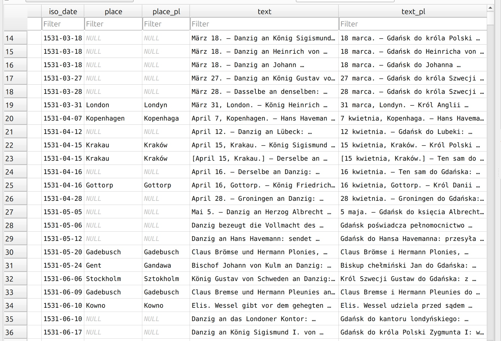
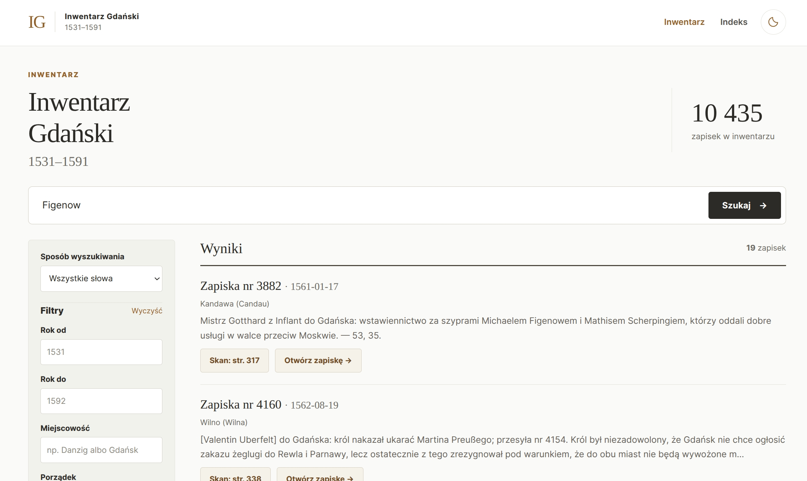
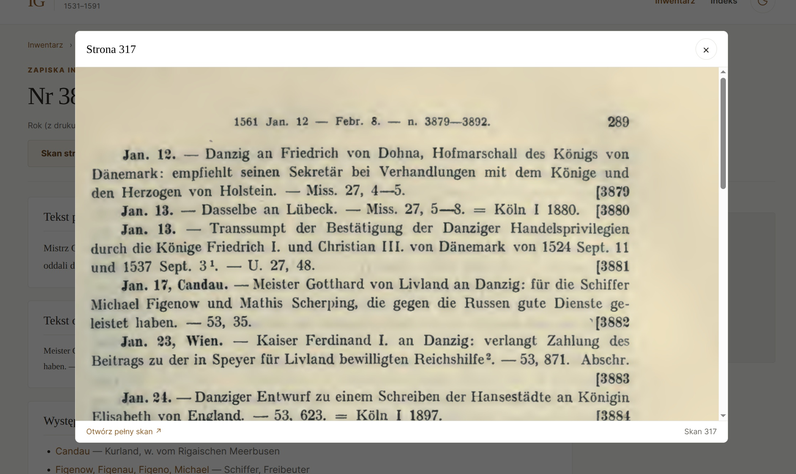

# Inwentarz Gdański 1531–1591 — aplikacja

Prosta aplikacja Python + Flask do przeglądania i wyszukiwania bazy danych utworzonej na podstawie publikacji:
Paul Simson, Danziger Inventar 1531–1591. Mit einem Akten-Anhang, München und Leipzig 1913.

Aplikacja jest częścią artykułu na blogu [ai.ihpan.edu.pl](https://ai.ihpan.edu.pl/pl/blog/2026-11/) opisującego test systemu agentowego Chronos. 

- **Inwentarz** — 10 435 zapisek (niemiecki + polski tekst, daty ISO, miejsca, numery zapisek),
- **Indeks** — 5 191 haseł z powiązaniami z zapiskami (klikalne numery) oraz odsyłaczami do aneksu („S. …”).

## Uruchomienie

```bash
cd /danzinger-app
python3 -m venv .venv-app && .venv-app/bin/pip install flask
.venv-app/bin/python app/app.py          # http://127.0.0.1:5057
```

Port / ścieżki można nadpisać zmiennymi środowiskowymi:
`DANZINGER_DB` (domyślnie `data/DANZIGER_INVENTAR_1531-1591/db/danziger_inventar.db`),
`DANZINGER_SCANS` (domyślnie `sources/DANZIGER_INVENTAR_1531-1591/png`),
`PORT` (domyślnie `5057`).

## Uwagi

- Skany ładowane są na żądanie (przycisk „Skan”) — endpoint `/skan/<strona>` serwuje pliki PNG z katalogu skanów.
- Baza jest otwierana wyłącznie do odczytu (`mode=ro`, `PRAGMA query_only=ON`).
- Wyszukiwanie pełnotekstowe: SQLite FTS5 (`remove_diacritics 2`), tryby: wszystkie słowa / fraza / składnia FTS.

## Ilustracje

Dane: 



Aplikacja: 




